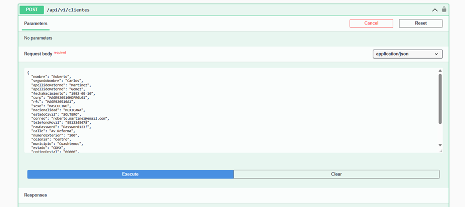
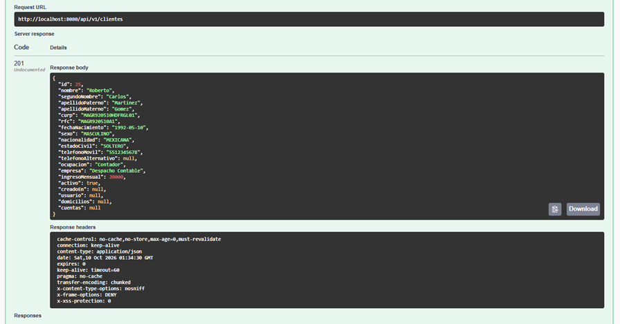
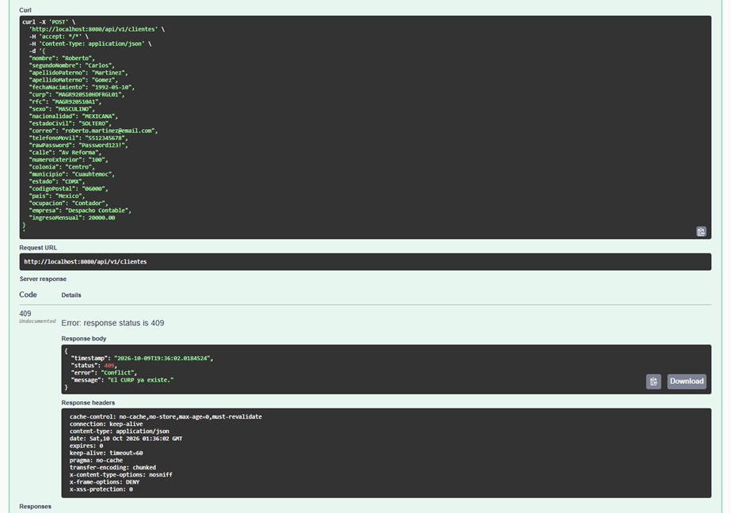
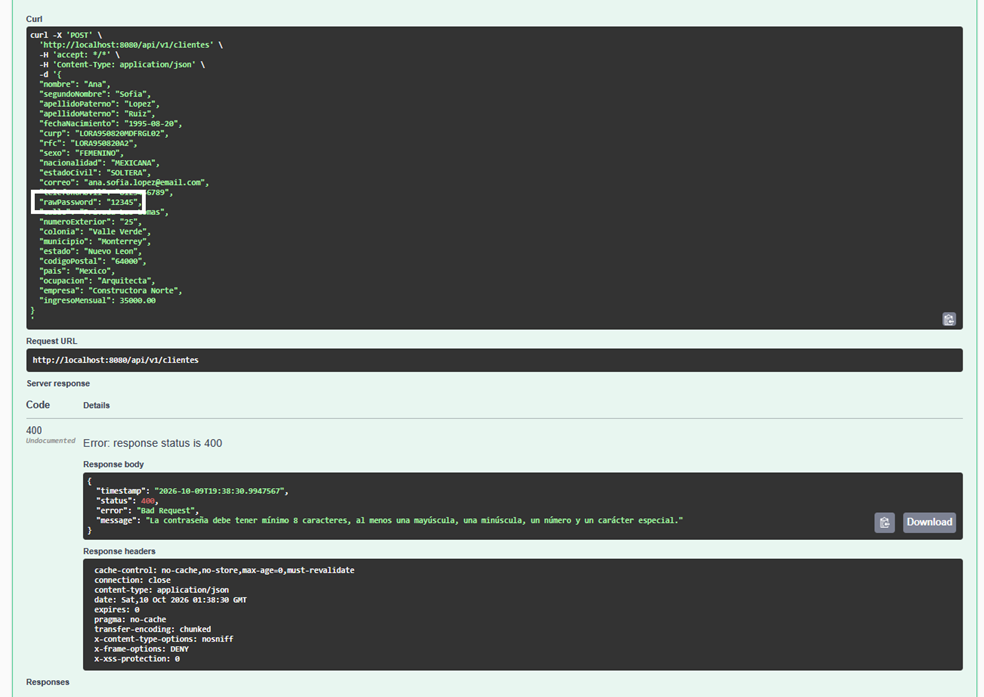
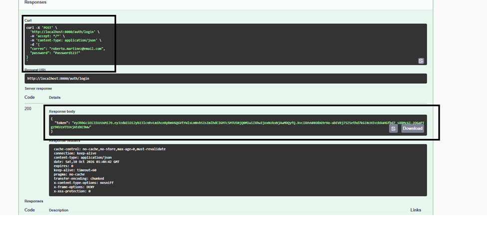
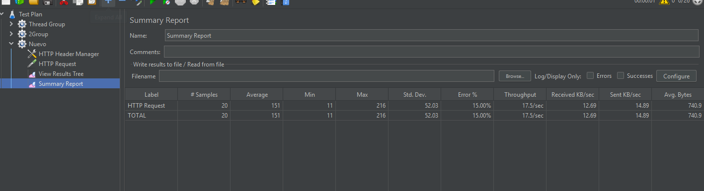
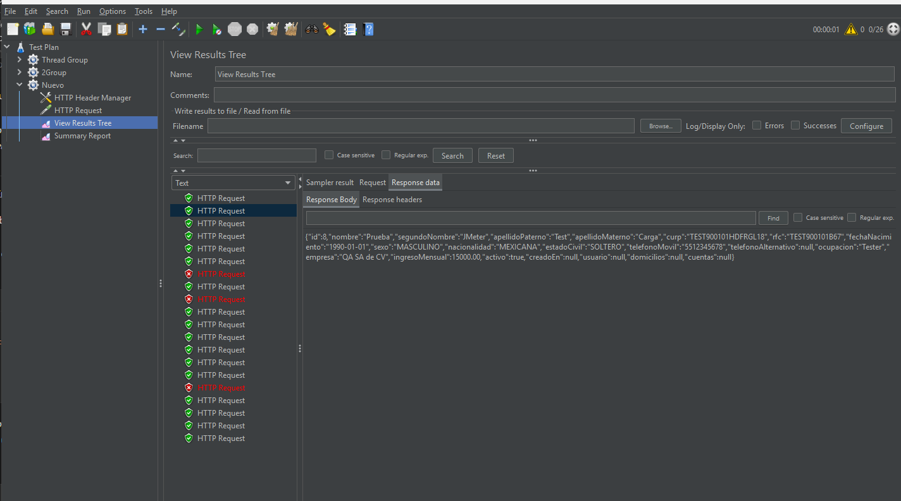

# Proyecto Integrador: Onboarding de Clientes Personas Físicas

**Docente:** Francisco Hasaní Barrera Portilla

**Materia:** Aplicaciones Web Progresivas

**Alumno:** Carlos Manuel Palma Muñoz

**Matrícula:** 1222100814

---

## 1. Objetivo del Proyecto
Desarrollar una aplicación backend robusta y segura mediante Java y Spring Boot que permita gestionar el registro (onboarding) de clientes personas físicas. El sistema valida estrictamente las reglas de negocio, persiste la información de manera relacional, crea automáticamente cuentas bancarias con saldo de $0.00, y genera credenciales de acceso seguras para los usuarios.

## 2. Arquitectura y Tecnologías Utilizadas
Para asegurar la escalabilidad, mantenibilidad y seguridad, la solución fue implementada bajo una arquitectura basada en capas (Controller, Service, Repository, Entity, DTO):

*   **Lenguaje:** Java 21 (o 17+)
*   **Framework:** Spring Boot 3.3.x
*   **Seguridad:** Spring Security (Stateless) con encriptación BCrypt y autenticación mediante JWT (JSON Web Tokens).
*   **Persistencia:** Spring Data JPA (Hibernate) conectado a PostgreSQL.
*   **Migraciones:** Flyway para el versionado seguro y automático del esquema de base de datos (DDL).
*   **Validaciones:** Spring Boot Starter Validation (Regex estrictas para CURP, RFC, Correos y contraseñas).

## 3. Diseño de la Base de Datos (Modelo Relacional)
Se diseñó un modelo de datos normalizado contemplando las siguientes entidades principales:
*   **clientes:** Contiene la información general, validada con llaves únicas (UK) en CURP y RFC.
*   **usuarios:** Entidad generada automáticamente al registrar el cliente. Almacena el correo y la contraseña cifrada (hash). Relación 1:1 con el cliente.
*   **cuentas:** Generada automáticamente al onboarding, vinculada al cliente (1:N).
*   **domicilios:** Almacena la ubicación física vinculada (1:N) al cliente.

*(Ver diagrama Entidad-Relación adjunto en los entregables del proyecto).*

## 4. Implementación de Reglas de Negocio
El sistema cumple con el 100% de las validaciones solicitadas:
1.  **Mayoría de edad:** Se calcula y rechaza mediante `ClienteService` si el usuario tiene menos de 18 años.
2.  **Unicidad:** La base de datos y el código previenen CURPs, RFCs y Correos duplicados.
3.  **Contraseñas Fuertes:** Se implementó una expresión regular que exige mínimo 8 caracteres, mayúscula, minúscula, número y carácter especial. Almacenada exclusivamente como Hash (BCrypt).
4.  **Cuentas Bancarias:** Al registrarse un cliente, se genera su cuenta en estatus `ACTIVA` y con saldo base de `$0.00` validado por anotaciones `@PositiveOrZero`.
5.  **Baja Lógica:** El endpoint `DELETE` inactiva al cliente y sus cuentas/usuarios en cascada lógica, sin borrar el registro físico.

## 5. Endpoints Principales (API REST)

### 5.1 Clientes
*   `POST /api/v1/clientes` - Registro de un nuevo cliente.
*   `GET /api/v1/clientes` - Obtener lista de clientes activos.
*   `GET /api/v1/clientes/{id}` - Búsqueda por ID.
*   `GET /api/v1/clientes/curp/{curp}` - Búsqueda por CURP.
*   `GET /api/v1/clientes/rfc/{rfc}` - Búsqueda por RFC.
*   `PUT /api/v1/clientes/{id}` - Actualización de datos (excepto CURP, RFC y Cuenta).
*   `DELETE /api/v1/clientes/{id}` - Baja lógica del cliente.

### 5.2 Cuentas
*   `GET /api/v1/cuentas/{numeroCuenta}` - Búsqueda de cuenta específica.
*   `GET /api/v1/cuentas/activas` - Lista de cuentas activas.
*   `GET /api/v1/cuentas/{numeroCuenta}/saldo` - Obtener saldo actual.

### 5.3 Seguridad y Autenticación
*   `POST /auth/login` - Inicio de sesión y emisión de JWT.
*   `GET /api/v1/usuarios/{id}` - Búsqueda de usuario.
*   `PUT /api/v1/usuarios/{id}/password` - Actualización de contraseña.

## 6. Evidencias de Pruebas Realizadas (Testing)
*(Añadir aquí capturas de pantalla)*

*   Postman: Registro Exitoso de Cliente (201 Created).
        
        
*   Postman: Error 409 Conflict por RFC/CURP Duplicado.
        
*   Postman: Error 400 Bad Request por contraseña débil.
        
*   Postman: Login exitoso devolviendo Token JWT.
        
*   JMeter: Prueba de Concurrencia (Summary Report y Results Tree comprobando 20 hilos simultáneos y bloqueos correctos).
        
        

---
**Conclusión:** La solución implementada es una API REST escalable, fuertemente tipada y con una arquitectura segura que cumple íntegramente con los criterios funcionales solicitados en el proyecto integrador.
