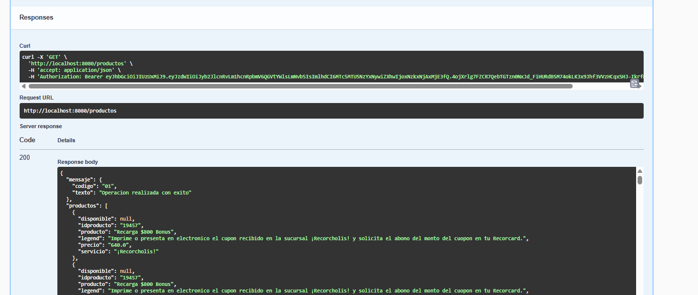
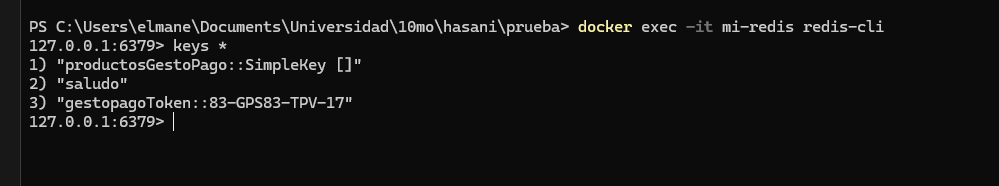
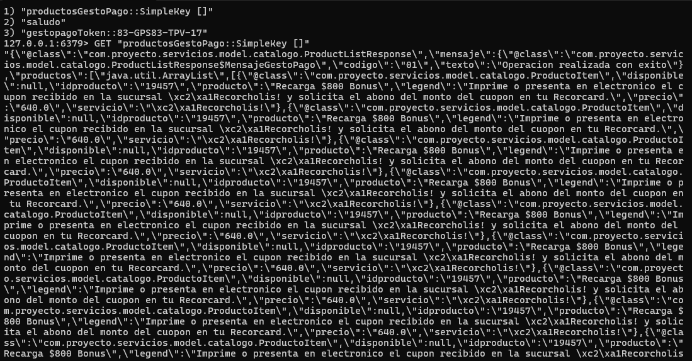
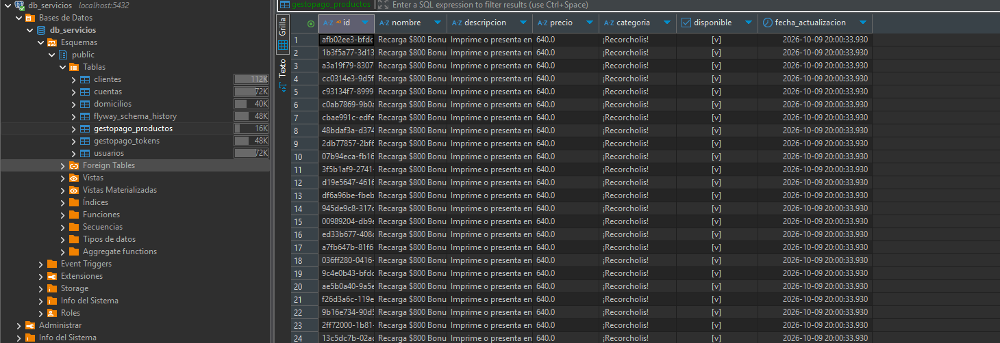
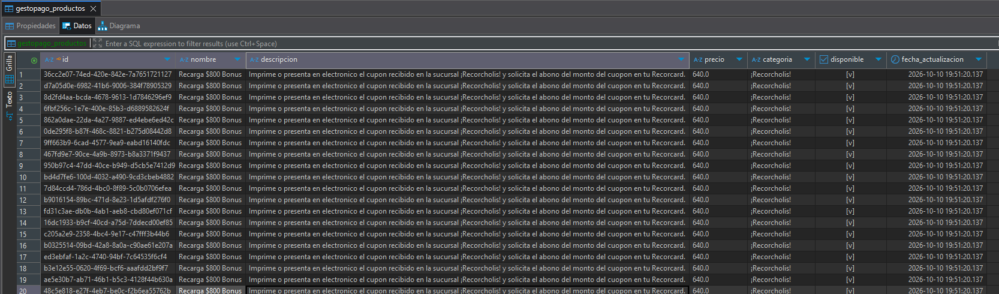
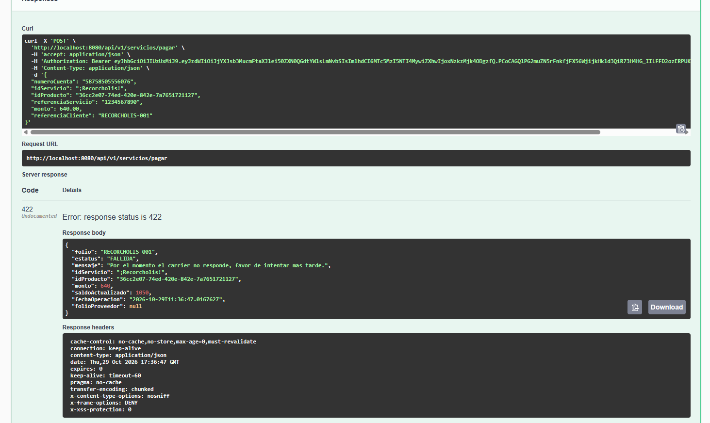
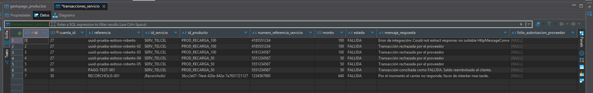

# Proyecto Integrador: Onboarding de Clientes Personas Físicas y Backend GestoPago

**Docente:** Francisco Hasaní Barrera Portilla

**Materia:** Aplicaciones Web Progresivas

**Alumno:** Carlos Manuel Palma Muñoz

**Matrícula:** 1222100814

---

# Proyecto de Integración Backend - GestoPago

Este repositorio contiene la implementación robusta de la integración entre nuestro backend interno y los servicios externos de **GestoPago**. La solución está construida sobre Spring Boot y se encarga de la obtención, almacenamiento en caché y persistencia local del catálogo de productos y tokens de autenticación de forma segura y automatizada.

---

## 1. Descripción General de la Solución

El objetivo principal del módulo es consumir el endpoint de catálogo de productos externo (`GET /sistema/service/getProductList.do`) administrado por GestoPago.

El flujo de integración está completamente automatizado y protegido:
* **Autenticación Dinámica:** El consumo del catálogo requiere un *Bearer Token*, el cual no está quemado (hardcoded) en el código. El sistema cuenta con un *Scheduler* que solicita dinámicamente el token utilizando las credenciales base parametrizadas en `application.properties`.
* **Sincronización Nocturna:** Un proceso Cron (job) se ejecuta de madrugada para refrescar de forma proactiva el catálogo.



---

## 2. Arquitectura de Capas e Implementación

El proyecto sigue una arquitectura limpia (Clean Architecture) dividida en las siguientes capas lógicas:

* **Controller:** Expone los endpoints internos para el consumo del frontend o aplicaciones satélites.
* **Service (`service` y `service.impl`):** Contiene la lógica de negocio, reglas de caché, validación y persistencia de base de datos.
* **Client / Integration (`client`):** Capa de comunicación HTTP declarativa utilizando **Spring Cloud OpenFeign** para dialogar con los endpoints de GestoPago.
* **DTOs (`model` y `entity`):** Mapeo de objetos de transferencia de datos (JSON) y entidades JPA.
* **Configuración (`config`):** Ajustes de Beans, configuración de Base de Datos y Caché.

### Patrón Cache-Aside: Redis + PostgreSQL
Implementamos un patrón híbrido de alta disponibilidad:
1. **Caché Primaria (Redis):** Cuando se solicita el catálogo, Spring consulta primero la memoria ultra-rápida de Redis (vía `@Cacheable`). 
2. **Persistencia Local (PostgreSQL):** Ante un *cache miss* (o ejecución programada), el sistema acude a GestoPago. Una vez obtenida la data, esta no solo se envía a Redis, sino que se sincroniza físicamente en PostgreSQL. 
3. **Manejo de UUIDs:** Para evitar fallos en los upserts masivos (causados por IDs genéricos o nulos de la API proveedora), el sistema limpia la tabla (`deleteAllInBatch`) y asigna UUIDs aleatorios locales a los 900+ productos antes de ejecutar un `saveAll()`, garantizando la consistencia relacional.




---

## 3. Configuración y Manejo de Credenciales

Toda la configuración sensible, URLs de endpoints, IDs de distribuidor, códigos de dispositivo y cron jobs se externalizaron en `application.properties`.
* **Protección de Secretos:** Ningún *password* o *token* se encuentra embebido en el código fuente de Java.
* **Manejo de Token en Memoria:** El *Bearer Token* es consumido desde GestoPago y almacenado temporalmente en Base de Datos y Redis. El servicio intercepta este token en memoria y lo inyecta limpiamente en las cabeceras HTTP de OpenFeign, protegiéndolo de exposición accidental.

---

## 4. Manejo de Excepciones y Resiliencia

El backend está preparado para fallos de red y caídas del proveedor externo:

* **ErrorDecoder Feign (`GestoPagoErrorDecoder`):** Intercepta respuestas HTTP (400, 401, 403, 404, 500, 503) desde GestoPago y las traduce en excepciones controladas.
* **GlobalExceptionHandler:** Utilizando `@RestControllerAdvice`, el sistema captura las fallas de comunicación, *Timeouts* de conexión y errores de autenticación, traduciéndolas en respuestas JSON homogéneas (`GenericResponse`). Nunca se exponen *Stack Traces* al usuario final.
* **Tolerancia a Fallos en Schedulers:** El job de sincronización nocturna envuelve su llamado en bloques *try-catch* para garantizar que un fallo en la API externa no congele o destruya el hilo principal de tareas de Spring Boot.

---

## 5. Estrategia de Logging y Monitoreo

La aplicación implementa SLF4J con estrategias claras de trazabilidad:
* **Trazabilidad de inicio a fin:** Se emiten logs (`log.info`) al arrancar una petición a GestoPago y al finalizarla, midiendo la cantidad de productos recuperados y persistidos.
* **Protección de Datos Sensibles:** La impresión del *Bearer Token* se ha omitido explícitamente en todos los niveles de log (incluso en nivel `DEBUG` de Feign) para cumplir con normativas de seguridad de la información.
* **Diagnóstico de Errores:** Excepciones externas generan trazas de error (`log.error`) detallando el código HTTP o causa de la falla para facilitar la tarea del equipo de soporte.

---

# Módulo 2: Onboarding de Clientes Personas Físicas

## 1. Objetivo del Proyecto
Desarrollar una aplicación backend robusta y segura mediante Java y Spring Boot que permita gestionar el registro (onboarding) de clientes personas físicas. El sistema valida estrictamente las reglas de negocio, persiste la información de manera relacional, crea automáticamente cuentas bancarias con saldo de $0.00, y genera credenciales de acceso seguras para los usuarios.

## 2. Arquitectura y Tecnologías Utilizadas
Para asegurar la escalabilidad, mantenibilidad y seguridad, la solución fue implementada bajo una arquitectura basada en capas (Controller, Service, Repository, Entity, DTO):

*   **Lenguaje:** Java 21 (o 17+)
*   **Framework:** Spring Boot 3.3.x
*   **Seguridad:** Spring Security (Stateless) con encriptación BCrypt y autenticación mediante JWT (JSON Web Tokens).
*   **Persistencia:** Spring Data JPA (Hibernate) conectado a PostgreSQL.
*   **Migraciones:** Flyway para el versionado seguro y automático del esquema de base de datos (DDL).
*   **Validaciones:** Spring Boot Starter Validation (Regex estrictas para CURP, RFC, Correos y contraseñas).

## 3. Diseño de la Base de Datos (Modelo Relacional)
Se diseñó un modelo de datos normalizado contemplando las siguientes entidades principales:
*   **clientes:** Contiene la información general, validada con llaves únicas (UK) en CURP y RFC.
*   **usuarios:** Entidad generada automáticamente al registrar el cliente. Almacena el correo y la contraseña cifrada (hash). Relación 1:1 con el cliente.
*   **cuentas:** Generada automáticamente al onboarding, vinculada al cliente (1:N).
*   **domicilios:** Almacena la ubicación física vinculada (1:N) al cliente.

*(Ver diagrama Entidad-Relación adjunto en los entregables del proyecto).*

## 4. Implementación de Reglas de Negocio
El sistema cumple con el 100% de las validaciones solicitadas:
1.  **Mayoría de edad:** Se calcula y rechaza mediante `ClienteService` si el usuario tiene menos de 18 años.
2.  **Unicidad:** La base de datos y el código previenen CURPs, RFCs y Correos duplicados.
3.  **Contraseñas Fuertes:** Se implementó una expresión regular que exige mínimo 8 caracteres, mayúscula, minúscula, número y carácter especial. Almacenada exclusivamente como Hash (BCrypt).
4.  **Cuentas Bancarias:** Al registrarse un cliente, se genera su cuenta en estatus `ACTIVA` y con saldo base de `$0.00` validado por anotaciones `@PositiveOrZero`.
5.  **Baja Lógica:** El endpoint `DELETE` inactiva al cliente y sus cuentas/usuarios en cascada lógica, sin borrar el registro físico.

## 5. Endpoints Principales (API REST)

### 5.1 Clientes
*   `POST /api/v1/clientes` - Registro de un nuevo cliente.
*   `GET /api/v1/clientes` - Obtener lista de clientes activos.
*   `GET /api/v1/clientes/{id}` - Búsqueda por ID.
*   `GET /api/v1/clientes/curp/{curp}` - Búsqueda por CURP.
*   `GET /api/v1/clientes/rfc/{rfc}` - Búsqueda por RFC.
*   `PUT /api/v1/clientes/{id}` - Actualización de datos (excepto CURP, RFC y Cuenta).
*   `DELETE /api/v1/clientes/{id}` - Baja lógica del cliente.

### 5.2 Cuentas
*   `GET /api/v1/cuentas/{numeroCuenta}` - Búsqueda de cuenta específica.
*   `GET /api/v1/cuentas/activas` - Lista de cuentas activas.
*   `GET /api/v1/cuentas/{numeroCuenta}/saldo` - Obtener saldo actual.

### 5.3 Seguridad y Autenticación
*   `POST /auth/login` - Inicio de sesión y emisión de JWT.
*   `GET /api/v1/usuarios/{id}` - Búsqueda de usuario.
*   `PUT /api/v1/usuarios/{id}/password` - Actualización de contraseña.

## 6. Evidencias de Pruebas Realizadas (Testing)
*(Añadir aquí capturas de pantalla)*

*   Postman: Registro Exitoso de Cliente (201 Created).
        
        
*   Postman: Error 409 Conflict por RFC/CURP Duplicado.
        
*   Postman: Error 400 Bad Request por contraseña débil.
        
*   Postman: Login exitoso devolviendo Token JWT.
        
*   JMeter: Prueba de Concurrencia (Summary Report y Results Tree comprobando 20 hilos simultáneos y bloqueos correctos).
        
        

---

# Módulo 3: Integración de Pagos de Servicios (GestoPago sendTx.do)

## 1. Descripción de la Solución Transaccional
Este módulo orquesta el ciclo de vida completo del pago de servicios y recargas electrónicas mediante la pasarela externa **GestoPago** (`POST /sistema/service/sendTx.do`).
Asegura la protección del saldo del cliente, previene duplicados e inconsistencias por caídas de red, y garantiza la trazabilidad bancaria de punta a punta.

## 2. Flujo de Operación y Arquitectura
1. **Autenticación y Autorización del Cliente:** La ruta `/api/v1/servicios/**` requiere autenticación JWT. Se valida que el cliente titular de la cuenta esté activo y que el usuario autenticado en `SecurityContextHolder` tenga autorización para operar la cuenta bancaria origen.
2. **Validación de Catálogo y Parámetros:** Se verifica que el producto exista, esté disponible, y que su categoría coincida con el `idServicio`. Si el producto tiene precio fijo, se valida estrictamente contra el monto enviado.
3. **Idempotencia y Prevención de Doble Clic:**
   - Se valida la clave única de idempotencia `referenciaCliente` (o UUID asignado).
   - Se comprueba una ventana temporal de 60 segundos en base de datos para bloquear ráfagas accidentales (doble clic) sobre el mismo servicio.
4. **Control de Concurrencia y Débito Preventivo (Hold-and-Settle):**
   - Se aplica `LockModeType.PESSIMISTIC_WRITE` (`SELECT FOR UPDATE`) sobre la cuenta.
   - Se verifica saldo suficiente y se realiza el débito preventivo registrando la transacción en estado `PENDIENTE`.
5. **Comunicación Externa con GestoPago:**
   - Invocación con `GestoPagoTxClient` mediante Bearer Token inyectado dinámicamente.
   - Si la respuesta es exitosa (`codigo: 0` o `status: SUCCESS`), se asienta el estado `EXITOSA` y se almacena el folio del proveedor (`201 Created`).
   - Si el proveedor rechaza la operación, se marca como `FALLIDA` y se **reversa el saldo** íntegro a la cuenta (`422 Unprocessable Entity`).
   - Si ocurre `GatewayTimeout` o `RetryableException`, se marca como `TIMEOUT` y **NO se reversa el saldo** para evitar pérdidas financieras (`202 Accepted`), enviándola a revisión/conciliación.
6. **Módulo de Consulta y Conciliación:**
   - `GET /api/v1/servicios/transacciones/{referencia}`: Consulta el estado de transacciones en curso o en `TIMEOUT`.
   - `POST /api/v1/servicios/transacciones/{referencia}/conciliar`: Permite conciliar operaciones indeterminadas y aplicar reembolsos cuando proceda.

## 3. Endpoints REST
* `POST /api/v1/servicios/pagar` - Procesa el pago debitando de la cuenta del cliente e interactuando con GestoPago.
* `GET /api/v1/servicios/transacciones/{referencia}` - Consulta el estado actual de una transacción.
* `POST /api/v1/servicios/transacciones/{referencia}/conciliar` - Concilia una transacción en estado TIMEOUT o PENDIENTE.

## 4. Análisis de Riesgos y Escenarios de Fallo
1. **Timeout con el Proveedor Externo:** Mitigado manteniendo el saldo en retención preventiva (`TIMEOUT`) y derivándolo a conciliación; nunca se asume fallo inmediato.
2. **Doble Clic en Frontend:** Mitigado por filtro de ventana temporal (60 segundos) y llaves de idempotencia.
3. **Concurrencia de Múltiples Solicitudes Simultáneas:** Mitigado por bloqueo pesimista en base de datos (`PESSIMISTIC_WRITE`).
4. **Manipulación de Montos:** Mitigado cotejando el importe enviado contra el precio oficial del catálogo en base de datos.
5. **Suplantación de Identidad:** Mitigado verificando la relación entre el JWT del usuario en sesión y la titularidad de la cuenta.

## 5. Pruebas Realizadas 

### 5.1 Catálogo de Servicios y Productos en Base de Datos (PostgreSQL)
El catálogo de productos se encuentra sincronizado físicamente en la base de datos PostgreSQL, garantizando la persistencia y permitiendo la validación cruzada de IDs, categorías y montos permitidos.



---

### 5.2 Petición de Pago de Servicio (¡Recórcholis! $640.00)
Operación ejecutada con autenticación Bearer JWT del cliente titular:

```bash
curl -X 'POST' \
  'http://localhost:8080/api/v1/servicios/pagar' \
  -H 'accept: application/json' \
  -H 'Authorization: Bearer <TOKEN_JWT_DEL_CLIENTE>' \
  -H 'Content-Type: application/json' \
  -d '{
  "numeroCuenta": "58758505556076",
  "idServicio": "¡Recorcholis!", 
  "idProducto": "36cc2e07-74ed-420e-842e-7a7651721127",
  "referenciaServicio": "1234567890",
  "monto": 640.00,
  "referenciaCliente": "RECORCHOLIS-001"
}'
```

---

### 5.3 Respuesta de la Pasarela GestoPago y Manejo Resiliente (HTTP 422)
GestoPago recibió la solicitud y retornó el XML de respuesta con el estado del carrier:
```xml
<?xml version='1.0' encoding='UTF-8'?>
<AUTORIZACION>
  <NUM_AUTORIZACION>-1</NUM_AUTORIZACION>
  <CODIGO_MENSAJE>03</CODIGO_MENSAJE>
  <MENSAJE>Por el momento el carrier no responde, favor de intentar mas tarde.</MENSAJE>
</AUTORIZACION>
```

El backend capturó y parseó la respuesta del proveedor, traduciéndola en la respuesta HTTP correspondiente y **reversando automáticamente el saldo debitado de vuelta a la cuenta del cliente**:

```json
{
  "folio": "RECORCHOLIS-001",
  "estatus": "FALLIDA",
  "mensaje": "Por el momento el carrier no responde, favor de intentar mas tarde.",
  "idServicio": "¡Recorcholis!",
  "idProducto": "36cc2e07-74ed-420e-842e-7a7651721127",
  "monto": 640,
  "saldoActualizado": 1050,
  "fechaOperacion": "2026-10-29T11:36:47.0167627",
  "folioProveedor": null
}
```


---

### 5.4 Registro y Trazabilidad en Base de Datos (transacciones_servicio)
Cada operación queda registrada en la tabla `transacciones_servicio` con su estado final (`FALLIDA`), mensaje original del switch y auditoría para fines de conciliación contable.



---

### 5.5 Endpoint de Conciliación de Transacciones
Para operaciones que queden en estado `TIMEOUT` o `PENDIENTE`, se cuenta con el endpoint de conciliación que permite asentar el folio definitivo del proveedor o reembolsar el saldo congelado:
* `POST /api/v1/servicios/transacciones/{referencia}/conciliar`

---
**Conclusión:** La solución implementada es una API REST escalable, fuertemente tipada y con una arquitectura segura que cumple íntegramente con los criterios funcionales solicitados en el proyecto integrador.
